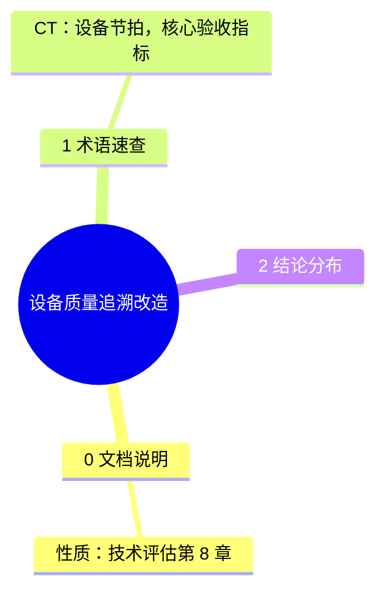

markdown-docs-helper
====

在浏览器里舒服地看一个目录下的 Markdown 与 Mermaid 思维导图文档，**不需要装任何 Markdown 插件**。

- **免安装、可离线**：不连 CDN、不用 `npm install`，双击 `md-viewer.html` 就能看。样式与应用逻辑在同目录的
  `assets/` 下，思维导图的渲染引擎（markmap + d3）已随仓库提供、由构建脚本内联进页面。
- **只读**：只读取文档目录，绝不修改、移动或删除任何 `.md` / `.mermaid` 文件（构建脚本的写入路径有代码级护栏，且明确禁止写进文档目录）。
- **按需显示**：首页内容与左侧目录栏显示哪些文档，都由 `config.json` 控制，不用改文档本身。
- **能看别人的目录**：把目录写在命令后面（`--serve <目录>`），页面里的路径前缀仍是 `docs/`，配置不用跟着改。
- **能分给同事看**：`node build-docs.mjs --serve --lan` 绑到本机所有网卡，启动时打印局域网地址，
  同一内网的同事打开即可（默认只绑 `127.0.0.1`，只有本机能开）。

# 快速开始

**方式一：实时模式（默认，文档改动不用重建）**

```
node build-docs.mjs --serve
```

然后打开 http://127.0.0.1:8899/ 。
此模式下打开的是实时版 `index.html`，页面直接读取文档目录下的 `.md` 原文，
**改文档、改配置、甚至新增文档，刷新页面即生效**。停止服务按 `Ctrl+C`。

想让同一局域网里的同事直接打开看，加 `--lan`：

```
node build-docs.mjs --serve --lan
```

启动时会把可用的地址都印出来（例如 `局域网访问：http://192.168.1.20:8899/`），
把那一行发给同事即可。默认**只绑 127.0.0.1**（只有本机能开），不写 `--lan` / `--host` 就不会
把文档暴露到网络上；服务没有鉴权，只建议在可信内网里这么用。

**方式二：直接双击（离线单文件）**

双击 `md-viewer.html` 即可。页面用内置数据副本，零依赖、可离线（`assets/` 目录要跟页面放在一起）。
文档或配置改动后，跑一次 `node build-docs.mjs` 再刷新页面。

**方式三：看别的目录**

```
node build-docs.mjs --serve "D:\some\project\docs"
```

文档不用搬进本工程。切换目录后如果左栏是空的，检查一下 `config.json` 的 `sidebar.folders` ——
它写的是 `docs/xxx` 这种**虚拟前缀**，与你真实的目录名无关。

> 两个页面都不引用任何互联网资源，全部走工程内的本地文件（`assets/`、`vendor/`）。

# 命令

```
node build-docs.mjs                        # 扫描 ./docs，写出全部产物：md-viewer.html、docs-index.json、index.html（改完 config 或文档后跑这个）
node build-docs.mjs <目录>                  # 换一个文档目录（可配合 --check / --serve 使用）
node build-docs.mjs --check [目录]          # 只检查产物是否已过期（过期时退出码为 1），不写文件
node build-docs.mjs --serve [目录]          # 启动本地实时服务（默认 8899，端口被占用或绑不上会自动往后找端口），
                                           # 访问 / 即进实时版；不写任何文件，页面在内存里现生成
node build-docs.mjs --serve --port 9000 [目录]
node build-docs.mjs --serve --lan [目录]    # 绑定所有网卡（0.0.0.0），同一局域网内可访问
node build-docs.mjs --serve --host 192.168.1.20 [目录]   # 只绑定指定的本机地址
node build-docs.mjs --help                 # 用法说明
```

目录是**位置参数**：写在参数前或参数后都可以，但最多只能写一个，不写就是工程自带的 `./docs`。
参数写错会直接报错退出，不会被静默忽略——未知参数、多写了一个目录、不存在的目录、
坏的端口号、坏的监听地址、`--serve` 与 `--check` 混用，都会当场拦下并提示正确写法。

## 监听地址（`--serve` 专用）

| 写法 | 绑定到 | 谁能打开 |
| --- | --- | --- |
| 不写（默认） | `127.0.0.1` | 只有本机 |
| `--lan` | `0.0.0.0`（所有网卡） | 本机 + 同一局域网/同一网络内的其它机器 |
| `--host <地址>` | 指定的 IP 或主机名（`0.0.0.0`、`::`、`192.168.1.20`、`localhost`…） | 能连到这个地址的人 |

`--host` 只写地址本身，端口用 `--port` 指定；`--lan` 就是 `--host 0.0.0.0` 的简写，
两个只能写一个。绑到 `0.0.0.0` / `::` 时启动信息会把本机各网卡的访问地址逐条印出来，
直接抄给同事即可：

```
  监听地址：0.0.0.0:8899（所有网卡，同一网络内的其它机器可以访问）
  本机访问：http://127.0.0.1:8899/       ← 实时版 index.html（引擎走本地外链）
  局域网访问：http://192.168.1.20:8899/
```

> 服务没有任何鉴权：绑定到 `0.0.0.0` 意味着同网络里知道地址的人都能读到这些文档。
> 只在可信内网里这么用；在公共 Wi-Fi 上请保持默认的 `127.0.0.1`。


用 `npm run` 也行：`npm run serve` / `npm run build` / `npm run check` / `npm test`。

# 工程结构

```
markdown-docs-helper/
├─ page.template.html   # 两个页面唯一的布局来源（改页面结构改这里；数据/引擎位置留空占位）
├─ md-viewer.html       # 离线单文件产物：内置文档数据 + 内联的导图/图表引擎，双击即可看
├─ index.html           # 实时版产物：引擎改成本地外链、快照置空，随构建命令一并生成（已在 .gitignore）
├─ assets/             # 页面的样式与应用逻辑（改动页面看这里，不用碰 html）
│  ├─ viewer.css       #   全部样式
│  ├─ mindmap-core.js  #   Mermaid mindmap 解析（纯函数，可单测）
│  ├─ mermaid-core.js  #   嵌入图表的围栏识别/版式判定/块标记（纯函数，可单测）
│  ├─ md-core.js       #   Markdown 渲染器
│  └─ md-app.js        #   应用逻辑（侧栏、路由、导图视图、图表渲染、导出…）
├─ build-docs.mjs      # 构建 / 本地服务脚本（把模板填成上面两个产物）
├─ config.json         # 配置文件（标题、首页说明、左栏显示范围、思维导图、图表…）—— 你主要改这个
├─ docs-index.json     # 生成的文档索引（实时模式用）
├─ vendor/markmap/     # 思维导图渲染引擎（markmap + d3，MIT），构建时内联或外链到页面
├─ vendor/mermaid/     # 嵌入图表的渲染引擎（mermaid，MIT），离线版按需内联、实时版本地外链
├─ docs/               # 默认被浏览的文档（示例内容，可以整个换掉）
│  ├─ 指南/
│  └─ 示例/
└─ test/               # 回归与调试脚本，见 test/README.md
```

`docs/` 只是默认值：目录参数可以指向任何位置的目录，页面内部仍用 `docs/` 作为虚拟前缀。

# 页面操作

页面上的按钮、键鼠操作、快捷键，以及实时版与离线快照版的差别，见
[`docs/指南/界面与快捷键.md`](docs/指南/界面与快捷键.md)。

# config.json 配置说明

标题、首页说明、左栏显示范围、右栏层级、思维导图等全部字段的默认值与示例，见
[`docs/指南/配置说明.md`](docs/指南/配置说明.md)。（配置写在工程根的 `config.json`，支持 `//` 注释与尾随逗号。）

# 思维导图（Mermaid mindmap）

文档目录里的 `.mermaid` 文件（Mermaid 的 `mindmap` 版式）会被渲染成思维导图，
和 Markdown 文档并列出现在左栏（带一个「导图」小标记），点开即在正文区显示。



对应写法（存成 `.mermaid` 文件，**不要**写 ```mermaid 围栏）：

```
mindmap
  root((设备质量追溯改造))
    0 文档说明
      性质：技术评估第 8 章
    1 术语速查
      CT：设备节拍，核心验收指标
```

画布上的操作（缩放 / 平移、折叠、跳大纲、导出图片、全屏、打印）见
[`docs/指南/界面与快捷键.md`](docs/指南/界面与快捷键.md) 的「思维导图操作」。

语法支持范围（按 Mermaid 的 `mindmap` 版式实现）：

- **缩进即层级**，不要求固定步长；`tab` 按 4 个空格算，与空格混用也没问题。
- **节点形状** 都会识别，只取其中的文字：`id[方形]`、`id(圆角)`、`id((圆形))`、
  `id{{六边形}}`、`id))爆炸((`、`id)云(`；纯文本节点按原样显示。
- **`%%` 注释与 `%%{init: …}%%` 指令**会被跳过；`mindmap` 声明行可有可无。
- **行内格式**：节点文字支持 Markdown 行内语法（粗体、行内代码等），但会被安全转义，
  所以节点里写 `#10`、`a*b*c` 这类内容不会破坏排版。
- `.mermaid` 文件里写的**不是** `mindmap`（比如 `stateDiagram-v2`）时，改由下面的
  嵌入图表引擎按整篇图表渲染，左栏标记也从「导图」变成「图表」。

> 渲染引擎是 [markmap](https://github.com/markmap/markmap)（MIT），已放在 `vendor/markmap/`，
> 由 `node build-docs.mjs` 填进页面：离线版整段内联，实时版走本地外链。升级方式见 `vendor/markmap/README.md`。

# 嵌入 Mermaid 图表（```mermaid 围栏）

Markdown 正文里用 ` ```mermaid ` 围栏包住 Mermaid 源码，页面就会把它画成 SVG，
和 `.mermaid` 思维导图一样**离线可用、不装插件、不联网**。


- 支持的版式：`stateDiagram-v2` / `stateDiagram`、`flowchart`、`sequenceDiagram`、
  `classDiagram`、`erDiagram`、`gantt`、`pie`、`journey`、`gitGraph`、`timeline`、
  `quadrantChart`、`requirementDiagram`、`mindmap`、`C4`、`sankey-beta` 等——凡是引擎认的都能画。
- 围栏写法：`` ```mermaid ``、`` ~~~mermaid ``、`` ```{.mermaid} `` 都认，大小写不敏感，附加信息串
  （`` ```mermaid title="x" ``）忽略；`` ```mermaidfoo `` 这类不算。
- 每张图右上角有工具栏：**源码**（就地摊开/收起）、**复制**、**SVG**（导出成文件）、**全屏**
  （铺满窗口，图按比例放大到放得下的最大尺寸——宽图顶满宽度、高图顶满高度，<kbd>Esc</kbd> 退出）。
  语法写错时不会白屏：显示一条含 Mermaid 报错的提示，
  下面自动摊开源码，同一篇文档里其它图表不受影响。
- 主题跟随页面深浅色（切主题会重画；mermaid 的主题是画进 SVG 里的）。
- 引擎是 [mermaid](https://github.com/mermaid-js/mermaid)（MIT），放在 `vendor/mermaid/`。
  **离线版按需内联**：这批文档里没有任何 ` ```mermaid ` 围栏、也没有整篇图表的 `.mermaid`
  文件时，`md-viewer.html` 不会背上这 3 MB（仍是 1 MB 上下），页面里留一个空引擎块兜底；
  实时版始终走本地外链。升级方式见 `vendor/mermaid/README.md`。

相关配置（`config.json` 的 `mermaid` 段，详见 [`docs/指南/配置说明.md`](docs/指南/配置说明.md)）：

```json
"mermaid": {
  "enabled": true,             // false：围栏退回普通代码块，离线版也不再内联引擎
  "theme": "auto",             // auto 跟随页面深浅色，也可写 default/dark/forest/neutral/base
  "style": "doc",              // doc：文档风（圆角浅紫胶囊 + 深灰粗连线 + 灰底标签 + 小三角箭头）；plain：mermaid 原样
  "securityLevel": "strict",   // strict 转义标签里的 HTML；文档可信时才改 loose（可用 <br/>）
  "controls": true,            // 图上的工具栏
  "exportImage": true,         // 工具栏里的「SVG」按钮
  "fullscreen": true           // 工具栏里的「全屏」按钮
}
```

可运行的示例见 [`docs/示例/Mermaid 图表.md`](docs/示例/Mermaid%20图表.md)（各类版式 + 故意写错的兜底），
整篇图表见 [`docs/示例/状态机示例.mermaid`](docs/示例/状态机示例.mermaid)，
样式对照见 [`docs/示例/状态图版式对照.md`](docs/示例/状态图版式对照.md)。

# 实时模式与离线快照

`--serve` 实时模式读文档目录原文（刷新即生效），双击 `md-viewer.html` 读页面内置快照（改完要重跑
`node build-docs.mjs`）。写盘边界很清楚：**只有 `node build-docs.mjs` 这条构建命令会写产物**，
`--serve` 与 `--check` 一个文件都不写（`--serve` 的实时版页面在内存里现生成），
所以 `--serve <别的目录>` 不会顶掉仓库里按默认 `docs/` 生成的 `md-viewer.html` / `docs-index.json`。
两种页面的差别、页面上的「数据来源」提示，以及产物过期检查
（`node build-docs.mjs --check`、`node test/why-stale.mjs`）见
[`docs/指南/界面与快捷键.md`](docs/指南/界面与快捷键.md)。

# 支持的 Markdown

ATX 标题、段落、围栏与缩进代码块、引用（含嵌套）、有序/无序/任务列表（含多层嵌套）、
GFM 表格（含对齐、转义竖线、行内代码）、水平线、行内 `code`/粗体/斜体/删除线/链接/图片/自动链接。
信息串为 `mermaid` 的围栏会画成图（见上面的「嵌入 Mermaid 图表」），其余围栏按代码高亮样式原样输出。

**原始 HTML 默认按纯文本转义输出**（`markdown.html: "escape"`），避免文档里混入脚本；
想让浏览器真正渲染或只留内容，改 `config.json` 即可（见下面的「正文里的 HTML」）。
正文里的 `</script>` 会被转义成 `\u003c`，不会提前闭合页面脚本标签。
样式与应用逻辑都在同目录的 `assets/` 下，页面没有任何外部（跨目录、跨站）请求。

## 正文里的 HTML

Markdown 正文里写的 HTML 标签怎么处理，由 `config.json` 的 `markdown.html` 决定
（**代码围栏与行内代码里的 HTML 永远是源码文本**，三种模式都不动它们）：

| 值 | 效果 |
| --- | --- |
| `"escape"`（默认） | 转义显示：`<div>` 就显示成 `<div>` 这行文字，文档安全，与以前的行为完全一致 |
| `"innerhtml"` | 原样输出：浏览器真去渲染，可写 `<details>` 折叠块、`<span style>` 着色等 |
| `"strip"` | 吃掉标签只留内容：`<div class="note">…</div>` 只剩里面的文字，按普通 Markdown 排版 |

`strip` 模式下：`<br>` 变换行（表格单元格里也生效）、`` 变图片（相对路径照常解析成文档目录下的
文件）、HTML 注释与 `<script>`/`<style>` 连内容一起消失、实体（`&amp;`、`&nbsp;`、`&#65;` 等）
还原成字符；`a < b`、`<user@example.com>` 这类不是标签的写法不会被误吃。想统一套壳、又不想让
标签影响排版时用它。

认不出的值一律按 `escape` 处理。`docs/xxx.md` 引用、`§` 章节引用、左栏摘要、右栏目录在三种模式下都照常可用。

> **安全提示**：`innerhtml` 是把文档当代码信任——`innerHTML` 插入的 `<script>` 不会执行，
> 但属性里的事件（如 ``）会执行。只在完全可信的文档上开这个模式；
> 块级标签与 Markdown 混排时，个别行的行距会不太整齐（属于浏览器解析的固有现象）。

## 跨文档章节引用（「父文档 §4.1」）

裸 `§4.1` 永远只指**本文档**的 4.1。要指别的文档，两种写法：

**一、零声明（推荐）**：目标路径的**行内代码**紧跟 `§` 编号即可，路径的写法与普通跨文档引用一致
（完整虚拟路径，或唯一的文件名）：

```markdown
细节见 `docs/方案/崩溃与掉电场景数据保障方案要点.md` §4.1，以及 `崩溃与掉电场景数据保障方案要点.md` §4.3。
```

**二、文首声明别名**：在正文开始前写声明区（可夹空行、可写在标题前后），
然后正文里就能写「别名 §编号」。别名随便取，可以声明多条：

```markdown
父文档指: `docs/方案/崩溃与掉电场景数据保障方案要点.md`
<!-- 总览: docs/方案/总体设计.md -->

# 文件写入原子化细则（Windows）

写盘顺序以 父文档 §4.1 为准，异常分支见 总览 §2.3。
```

- 声明行**不会**渲染成正文，而是在文章顶部变成一排可点的「引用目标」徽标（父文档 → 崩溃与掉电场景数据保障方案要点），既能核对指向、也能当"回上级"用；
- 注释写法 `<!-- 别名: 路径 -->` 在别的 Markdown 工具里完全不显示，可见行写法 `别名指: \`路径\`` 更好读，两种都能用；
- 声明区只认**正文开始前**的部分（最多扫前 40 行），正文中间的 `XX: docs/xx.md` 不会被误吞；
- 目标文档里找不到该编号时不会静默失效：链接跳到目标文档顶部，并标成**黄色虚线 + 悬停说明**（`missing`）；
- 声明的目标文件找不到时，顶部徽标变黄并标「找不到」；
- 跳转落点会**闪一下**，确认真的跳到了目标章节。

> 声明只影响本文档里带该别名的引用；不写声明时行为与以前完全一致。
> 目前不支持在 Markdown 链接里写纯数字锚点（`[文字](docs/x.md#4.1)`），要指定章节请用上面两种写法。

# 测试与调试脚本

详见 `docs/指南/测试与调试脚本.md`。

# 常见问题

**改了 `config.json` 没反应？**
双击模式下需要重跑 `node build-docs.mjs`；实时模式下确认是浏览器缓存——本工具已设 `no-store`，
正常刷新即可（`Ctrl+F5` 强制刷新更保险）。

**新增的文档没出现在左栏？**
`sidebar.folders` 非空时是白名单，新目录不会被自动收录；把新目录加进 `folders`，或把 `folders` 设为 `[]`。

**换了一个文档目录之后左栏空了？**
`folders` / `exclude` / `docs` 里的路径都带 `docs/` 前缀（虚拟前缀，与真实目录名无关）。
例如 `node build-docs.mjs --serve D:\proj\docs` 时，`D:\proj\docs\设计\x.md` 的路径就是 `docs/设计/x.md`。

**启动后看不到我想看的目录？**
先看脚本启动时打印的 `文档目录：` 一行（命令行指定过的话会标注「命令行指定」），
它才是真正被扫描的目录；端口被占用或绑不上时脚本会自动往后找端口，所以请以打印的
`本机访问：http://127.0.0.1:xxxx/` 为准，别打开上一次遗留的旧服务。

**`--port 9001` 报「没有权限绑定 / EACCES」？**
端口没被系统占用，也可能绑不上：Windows 上**别的程序独占监听**该端口时，第二次 `bind`
返回的就是 `EACCES`（`WSAEACCES 10013`），而不是 `EADDRINUSE`——所以「小于 1024 需要
管理员权限」的说法对 9001 这种端口并不成立。现在脚本把这种 `EACCES` 也当成「端口用不了」，
自动往后顺延并在启动信息里打印真实端口；想知道是谁占着，可以自己查：

```
netstat -ano | findstr :9001                                  # 看那一行的 PID 是哪个程序
netsh interface ipv4 show excludedportrange protocol=tcp      # 看系统预留（Hyper-V/WSL/Docker）的端口段
tasklist | findstr <PID>                                      # Windows 上由 PID 反查程序名
```

（实测：`mosquitto` 占着 `0.0.0.0:9001` 时，`node build-docs.mjs --serve --port 9001`
报的就是 `EACCES`。换个端口，或停掉那个程序即可。）

**怎么让同事也能看这些文档？**
用 `node build-docs.mjs --serve --lan` 起服务，把启动信息里的
`局域网访问：http://<你的IP>:<端口>/` 那一行发给同事（要能互相 ping 通、防火墙别拦）。
只想绑某一个地址就写 `--host <你的IP>`。服务没有鉴权，只建议在可信内网里用；
用完之后 `Ctrl+C` 停掉即可，默认（不写 `--lan` / `--host`）永远只绑本机。

**某篇文档搜不到？**
可能被 `sidebar.docs` 隐藏了，或被 `sidebar.exclude` 排除了。左栏底部会显示「当前显示 N 篇」，
与总篇数不一致时说明有过滤。

**表格太宽？**
表格区域可横向滚动（不会挤坏版面）；打印时会整体输出，必要时在打印预览里选横向纸张。

**能编辑文档吗？**
不能，本工具是只读的。编辑请直接用你的 Markdown 编辑器改文档目录下的文件。

**为什么目录里的 pptx / xlsx 不显示？**
本工具只处理 Markdown（`.md`）与思维导图 / 图表（`.mermaid`）；其他文件会被忽略，左栏底部会显示忽略的数量。

**```mermaid 围栏只显示成代码块，没画成图？**
先看 `config.json` 里 `mermaid.enabled` 是不是 `false`（关掉时围栏就是普通代码块，这是刻意行为）。
是 `true` 却还没画，多半是双击模式的页面还没重建：改文档或配置后要重跑 `node build-docs.mjs`；
实时模式刷新即可。另外确认那一段确实用了 ```mermaid 围栏（` ```mindmap ` 这种信息串不算）。

**某张图显示「这张 Mermaid 图没能画出来」？**
Mermaid 自己的语法错误，提示里带了行号，源码已自动摊开——照着改那段源码即可，同一篇文档里
其它图表不受影响。想核对写法，看 `docs/示例/Mermaid 图表.md` 里各类版式的例子。

**图表里的 `<br/>` 没换行？**
`securityLevel` 默认 `strict`，标签里的 HTML 会被转义（与正文 HTML 的默认转义显示一致）。
确实要用 `<br/>` 时，把 `config.json` 的 `mermaid.securityLevel` 改成 `loose`（文档可信的前提下）。

**正文里的 `<details>` / `<span>` 等 HTML 没渲染，直接显示了标签文字？**
默认 `markdown.html: "escape"` 就是转义显示（刻意行为，文档安全）。想真正渲染改成 `"innerhtml"`，
只想吃掉标签留内容改成 `"strip"`；三种模式的取舍与注意事项见上面的「正文里的 HTML」一节。

**离线单文件怎么突然大了 3 MB？**
`md-viewer.html` 的图表引擎是**按需内联**的：这批文档里有 ```mermaid 围栏（或整篇图表的
`.mermaid`）时才把 `vendor/mermaid/mermaid.min.js` 写进页面。所以把示例文档挪出文档目录再重建，
体积就会回到 1 MB 上下；`mermaid.enabled = false` 也能去掉它。

**思维导图没渲染出来 / 左栏没有「导图」标记？**
先确认后缀是 `.mermaid`（或在 `config.json` 的 `mindmap.extensions` 里加上你的后缀），
再看 `mindmap.enabled` 是不是 `false`。双击模式下改完配置要重跑 `node build-docs.mjs`。
如果导图区域显示了红色提示，说明文件里没解析出节点——检查层级是否靠缩进（`tab` 记 4 个空格），
并且不要写 ```mermaid 代码围栏。
（另外：`.mermaid` 里写的是 `stateDiagram-v2` 这类版式时，会按「图表」渲染，左栏标记是「图表」而不是「导图」。）

**导图太挤 / 字被截断？**
节点文字按 `maxWidth`（320px）折行。导图整体很宽时先点「适应」，或折叠掉不需要的分支再看。

**导图想看得更大？**
点导图工具栏的「全屏」：导图会铺满整个浏览器窗口（顶栏、两侧栏都被盖住），再点一次按钮或按 `Esc` 还原；
想连浏览器的地址栏也收掉，在「全屏」基础上再按 `F11`。

# 设计要点

- **为什么把文档内嵌进 HTML**：`file://` 页面无法 `fetch`/XHR 本地文件，也无法列目录，
  所以双击模式必须把数据写进页面；`--serve` 模式才实时读文件。页面布局只维护
  `page.template.html` 一份，`build-docs.mjs` 把四处空占位（两段 JSON 数据 + 四个引擎块）
  填成两个产物：离线版内联、实时版外链。除此之外模板一字不改。
- **为什么把样式和逻辑放在 `assets/`**：页面本体只留结构与内置数据，改样式/逻辑直接编辑
  `assets/viewer.css`、`assets/md-app.js` 等文件，刷新即生效，不用在两千多行的 HTML 里翻。
  它们是普通的 `<link>` / `<script src>`，`file://` 与 `--serve` 下都能加载，也不影响离线使用；
  代价是拷贝给别人时要连 `assets/` 目录一起带上。离线版还需要 `vendor/` 一起带（引擎内联在页面里），
  实时版则额外需要 `vendor/`（它按外链读）。
- **为什么离线版把引擎内联**：同一个原因——`file://` 加载不了外部脚本。所以
  `vendor/markmap/` 下的 markmap-lib、markmap-view、d3 会在构建时整段写进
  `<script id="vendor-…">` 块（顺序不能改：d3 必须在前，view 是 `(this.markmap, d3)` 形式的 IIFE）。
  代价是 `md-viewer.html` 大了约 950 KB，换来的是双击即可离线看导图；实时版没这个限制，
  所以走外链，`index.html` 只有几 KB。两个页面都不引用任何互联网资源。
  嵌入图表的 `vendor/mermaid/mermaid.min.js` 有 3.2 MB，太大，所以**按需内联**：这批文档里
  用到了 Mermaid 图表才写进页面，否则只留一个标了 `data-unused="1"` 的空块；
  页面侧统一用「`window.mermaid` 在不在」判断，缺引擎时围栏就是普通代码块，不会白屏。
- **嵌入图表为什么也自己写解析层**：围栏识别、版式判定、块标记放在
  `assets/mermaid-core.js`（纯函数、可单测），构建脚本用 `vm` 把同一份源码读进来判断
  「要不要内联引擎」——判定规则只有一份，页面与构建永远一致。渲染本身完全交给 mermaid，
  页面只做排队（一张张画，顺序稳定）、成败兜底（错误框 + 源码）、主题重画与工具栏。
- **导图与大纲怎么保持同步**：markmap 渲染前会把数据深拷贝成自己的 INode 树，它写的 `fold`
  回不到我们的树。因为两棵树形状必然一致（同一份 `.mermaid`、同序前序遍历，节点数相同），
  所以按**前序遍历序号**对应，而不是按文字比对（markmap 的节点文字是 HTML、中文还被转成
  `&#x…;` 实体，比对很容易踩坑）。画布点击后再把 fold 回写到大纲。
- **只读怎么保证**：`assertInsideRoot()` 拒绝写出工程之外，也拒绝写进文档目录；
  渲染器默认不解析原始 HTML（导图节点文字也做 Markdown 转义），只有显式把
  `markdown.html` 改成 `innerhtml` 时才把文档当可信代码渲染；页面本身没有任何写文件能力。
- **侧栏动画**：左栏负外边距滑出、右栏收窄裁剪，都不重排正文；细节见
  [`docs/指南/界面与快捷键.md`](docs/指南/界面与快捷键.md) 的「侧栏开关的实现要点」。
