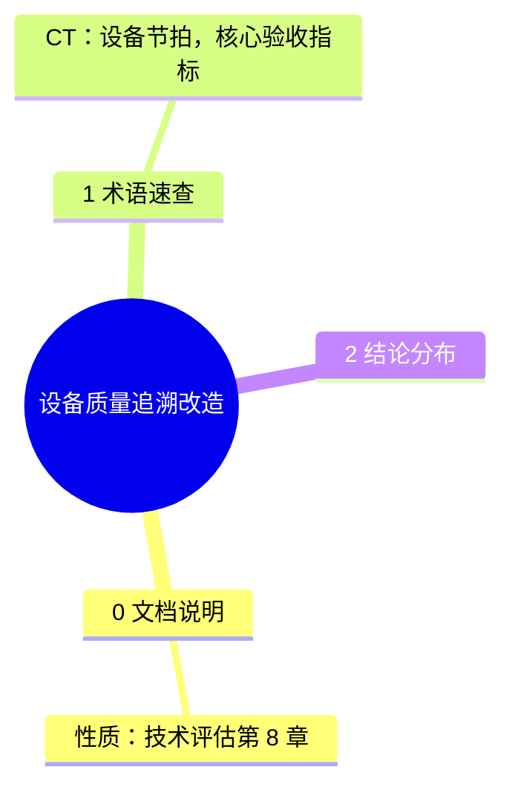

markdown-docs-helper
====

在浏览器里舒服地看一个目录下的 Markdown 与 Mermaid 思维导图文档，**不需要装任何 Markdown 插件**。

- **免安装、可离线**：不连 CDN、不用 `npm install`，双击 `md-viewer.html` 就能看。样式与应用逻辑在同目录的
  `assets/` 下，思维导图的渲染引擎（markmap + d3）已随仓库提供、由构建脚本内联进页面。
- **只读**：只读取文档目录，绝不修改、移动或删除任何 `.md` / `.mermaid` 文件（构建脚本的写入路径有代码级护栏，且明确禁止写进文档目录）。
- **按需显示**：首页内容与左侧目录栏显示哪些文档，都由 `config.json` 控制，不用改文档本身。
- **能看别人的目录**：把目录写在命令后面（`--serve <目录>`），页面里的路径前缀仍是 `docs/`，配置不用跟着改。
- **能分给同事看**：`node build-docs.mjs --serve --lan` 绑到本机所有网卡，启动时打印局域网地址，
  同一内网的同事打开即可（默认只绑 `127.0.0.1`，只有本机能开）。

# 快速开始

**方式一：实时模式（默认，文档改动不用重建）**

```
node build-docs.mjs --serve
```

然后打开 http://127.0.0.1:8899/ 。
此模式下打开的是实时版 `index.html`，页面直接读取文档目录下的 `.md` 原文，
**改文档、改配置、甚至新增文档，刷新页面即生效**。停止服务按 `Ctrl+C`。

想让同一局域网里的同事直接打开看，加 `--lan`：

```
node build-docs.mjs --serve --lan
```

启动时会把可用的地址都印出来（例如 `局域网访问：http://192.168.1.20:8899/`），
把那一行发给同事即可。默认**只绑 127.0.0.1**（只有本机能开），不写 `--lan` / `--host` 就不会
把文档暴露到网络上；服务没有鉴权，只建议在可信内网里这么用。

**方式二：直接双击（离线单文件）**

双击 `md-viewer.html` 即可。页面用内置数据副本，零依赖、可离线（`assets/` 目录要跟页面放在一起）。
文档或配置改动后，跑一次 `node build-docs.mjs` 再刷新页面。

**方式三：看别的目录**

```
node build-docs.mjs --serve "D:\some\project\docs"
```

文档不用搬进本工程。切换目录后如果左栏是空的，检查一下 `config.json` 的 `sidebar.folders` ——
它写的是 `docs/xxx` 这种**虚拟前缀**，与你真实的目录名无关。

> 两个页面都不引用任何互联网资源，全部走工程内的本地文件（`assets/`、`vendor/`）。

# 命令

```
node build-docs.mjs                        # 扫描 ./docs，刷新 md-viewer.html 内置数据（改完 config 或文档后跑这个）
node build-docs.mjs <目录>                  # 换一个文档目录（可配合 --check / --serve 使用）
node build-docs.mjs --check [目录]          # 只检查产物是否已过期（过期时退出码为 1）
node build-docs.mjs --serve [目录]          # 启动本地实时服务（默认 8899，被占用会自动往后找端口），
                                           # 并生成实时版 index.html；访问 / 即进实时版
node build-docs.mjs --serve --port 9000 [目录]
node build-docs.mjs --serve --lan [目录]    # 绑定所有网卡（0.0.0.0），同一局域网内可访问
node build-docs.mjs --serve --host 192.168.1.20 [目录]   # 只绑定指定的本机地址
node build-docs.mjs --help                 # 用法说明
```

目录是**位置参数**：写在参数前或参数后都可以，但最多只能写一个，不写就是工程自带的 `./docs`。
参数写错会直接报错退出，不会被静默忽略——未知参数、多写了一个目录、不存在的目录、
坏的端口号、坏的监听地址、`--serve` 与 `--check` 混用，都会当场拦下并提示正确写法。

## 监听地址（`--serve` 专用）

| 写法 | 绑定到 | 谁能打开 |
| --- | --- | --- |
| 不写（默认） | `127.0.0.1` | 只有本机 |
| `--lan` | `0.0.0.0`（所有网卡） | 本机 + 同一局域网/同一网络内的其它机器 |
| `--host <地址>` | 指定的 IP 或主机名（`0.0.0.0`、`::`、`192.168.1.20`、`localhost`…） | 能连到这个地址的人 |

`--host` 只写地址本身，端口用 `--port` 指定；`--lan` 就是 `--host 0.0.0.0` 的简写，
两个只能写一个。绑到 `0.0.0.0` / `::` 时启动信息会把本机各网卡的访问地址逐条印出来，
直接抄给同事即可：

```
  监听地址：0.0.0.0:8899（所有网卡，同一网络内的其它机器可以访问）
  本机访问：http://127.0.0.1:8899/       ← 实时版 index.html（引擎走本地外链）
  局域网访问：http://192.168.1.20:8899/
```

> 服务没有任何鉴权：绑定到 `0.0.0.0` 意味着同网络里知道地址的人都能读到这些文档。
> 只在可信内网里这么用；在公共 Wi-Fi 上请保持默认的 `127.0.0.1`。


用 `npm run` 也行：`npm run serve` / `npm run build` / `npm run check` / `npm test`。

# 工程结构

```
markdown-docs-helper/
├─ page.template.html   # 两个页面唯一的布局来源（改页面结构改这里；数据/引擎位置留空占位）
├─ md-viewer.html       # 离线单文件产物：内置文档数据 + 内联的思维导图引擎，双击即可看
├─ index.html           # 实时版产物：引擎改成本地外链、快照置空，--serve 时自动生成（已在 .gitignore）
├─ assets/             # 页面的样式与应用逻辑（改动页面看这里，不用碰 html）
│  ├─ viewer.css       #   全部样式
│  ├─ mindmap-core.js  #   Mermaid mindmap 解析（纯函数，可单测）
│  ├─ md-core.js       #   Markdown 渲染器
│  └─ md-app.js        #   应用逻辑（侧栏、路由、导图视图、导出…）
├─ build-docs.mjs      # 构建 / 本地服务脚本（把模板填成上面两个产物）
├─ config.json         # 配置文件（标题、首页说明、左栏显示范围、思维导图…）—— 你主要改这个
├─ docs-index.json     # 生成的文档索引（实时模式用）
├─ vendor/markmap/     # 思维导图渲染引擎（markmap + d3，MIT），构建时内联或外链到页面
├─ docs/               # 默认被浏览的文档（示例内容，可以整个换掉）
│  ├─ 指南/
│  └─ 示例/
└─ test/               # 回归与调试脚本，见 test/README.md
```

`docs/` 只是默认值：目录参数可以指向任何位置的目录，页面内部仍用 `docs/` 作为虚拟前缀。

# 页面操作

| 操作 | 方式 |
| --- | --- |
| 开关左侧目录栏 | 工具栏最左侧按钮，或快捷键 `[`，或左栏右上角 `✕` |
| 开关右侧目录栏 | 工具栏最右侧按钮，或快捷键 `]`，或右栏右上角 `✕` |
| 搜索 | 左栏搜索框（文件名 + 全文），快捷键 `/` 聚焦，`Esc` 清除 |
| 打开文档 | 点左栏条目、点首页卡片，或直接点正文里 `docs/xxx.md` 形式的引用 |
| 跳转章节 | 点正文里的 `§5.3` 这类引用，或点右栏目录 |
| 上一篇 / 下一篇 | 工具栏按钮（顺序与左栏一致） |
| 切换深/浅色 | 工具栏「深色/浅色」按钮（跟随系统偏好，且记住选择） |
| 打印 / 导出 PDF | 工具栏「打印」，或 `Ctrl+P` → 目标选「另存为 PDF」 |
| 复制当前文档链接 | 工具栏「链接」（链接带文档与章节位置，可直接发给别人） |
| 导图全页面显示 | 导图工具栏「全屏」按钮：把导图铺满整个浏览器窗口，再点一次或按 `Esc` 还原（`F11` 也能叠加使用） |

侧栏的开关状态会记住（默认开启记忆，可在 `config.json` 里关掉）。窄屏/手机上两侧栏变成抽屉，
默认都收起，点工具栏按钮滑出，点空白处或 `✕` 收起。

# config.json 配置说明

配置文件里**允许写 `//` 与 `/* */` 注释，也允许尾随逗号**，随便加说明。写错了不要紧：页面首页会显示红色提示，并自动退回默认设置（不会白屏）。

## 顶部与首页

| 字段 | 默认值 | 说明 |
| --- | --- | --- |
| `title` | `"Markdown 文档浏览器"` | 顶栏主标题 |
| `subtitle` | `""` | 顶栏副标题（窄屏自动隐藏） |
| `home.title` | `"文档索引"` | 首页大标题，设为 `""` 则不显示 |
| `home.intro` | `""` | 首页引导语，**支持 Markdown**；留空则不显示这一段 |
| `home.showCards` | `true` | 首页是否显示文档卡片列表 |

`home.intro` 里写 `docs/示例/快速开始.md` 会自动变成可点击的跳转链接，例如：

```jsonc
"home": {
  "title": "文档索引",
  "intro": "## 使用须知\n\n本页只读展示，不改文档。\n\n- 左栏：`[` 开关\n- 详细说明见 `docs/指南/快速开始.md`",
  "showCards": true
}
```

## 左侧目录栏

| 字段 | 默认值 | 说明 |
| --- | --- | --- |
| `sidebar.title` | `"文档目录"` | 左栏标题 |
| `sidebar.defaultOpen` | `false` | 默认是否展开（窄屏一律默认收起） |
| `sidebar.remember` | `true` | 是否记住上次的开关状态 |
| `sidebar.showSearch` | `true` | 是否显示搜索框 |
| `sidebar.showCounts` | `true` | 分组名右侧是否显示篇数 |
| `sidebar.folders` | `[]` | 只显示列出的目录，并按此顺序排列；**空数组 = 显示全部目录** |
| `sidebar.exclude` | `[]` | 额外排除的目录前缀或单个文件路径 |
| `sidebar.order` | `[]` | 让指定文档排在前面（按数组顺序） |
| `sidebar.docs` | `{}` | 单篇覆盖：隐藏某篇，或改它的显示标题（都不动 md 文件） |

`folders` 的两种写法（`label` 是显示名，可随意改成中文）：

```jsonc
"folders": [
  { "dir": "docs/指南", "label": "指南" },
  { "dir": "docs/示例", "label": "示例" }
]
```

单篇隐藏与改名：

```jsonc
"docs": {
  "docs/示例/表格与代码.md": { "hidden": true },          // 不在左栏与首页出现
  "docs/指南/快速开始.md": { "title": "改过的显示名" }     // 只改显示标题
}
```

被 `hidden` 隐藏的文档**仍然可以通过正文里的 `docs/xxx.md` 引用打开**（只是不列出来、搜索结果里也不出现）。

## 右侧目录栏与阅读区

| 字段 | 默认值 | 说明 |
| --- | --- | --- |
| `toc.title` | `"本篇目录"` | 右栏标题 |
| `toc.defaultOpen` | `true` | 默认是否展开（当前默认：只开右侧栏） |
| `toc.remember` | `true` | 是否记住上次的开关状态 |
| `toc.maxDepth` | `4` | 右上目录收录到几级标题（`2` 只到二级，`3` 到三级，`4` 最多四级） |
| `reading.maxWidth` | `920` | 正文最大宽度（像素）。嫌一行太长就调小，嫌窄就调大 |

## 思维导图（`.mermaid`）

| 字段 | 默认值 | 说明 |
| --- | --- | --- |
| `mindmap.enabled` | `true` | 总开关。设成 `false` 后 `.mermaid` 只当普通文本显示，左栏也不再标「导图」 |
| `mindmap.extensions` | `[".mermaid"]` | 哪些后缀按思维导图渲染（写 `"mermaid"` 或 `".MERMAID"` 都认） |
| `mindmap.initialExpandLevel` | `2` | 打开时展开到第几层：`1` 只展开一级分支，`2` 再展开一层，`0` 全部展开，`-1` 全部折叠 |
| `mindmap.showOutline` | `true` | 右栏是否显示导图大纲（可点击定位、点三角折叠） |
| `mindmap.exportImage` | `true` | 是否显示导图工具栏上的 SVG / PNG 导出按钮 |

```jsonc
"mindmap": {
  "enabled": true,
  "extensions": [".mermaid"],
  "initialExpandLevel": 2,
  "showOutline": true,
  "exportImage": true
}
```

# 思维导图（Mermaid mindmap）

文档目录里的 `.mermaid` 文件（Mermaid 的 `mindmap` 版式）会被渲染成思维导图，
和 Markdown 文档并列出现在左栏（带一个「导图」小标记），点开即在正文区显示。



对应写法（存成 `.mermaid` 文件，**不要**写 ```mermaid 围栏）：

```
mindmap
  root((设备质量追溯改造))
    0 文档说明
      性质：技术评估第 8 章
    1 术语速查
      CT：设备节拍，核心验收指标
```

| 操作 | 方式 |
| --- | --- |
| 缩放 / 平移 | 滚轮缩放、拖拽平移；双击画布或点「适应」回到合适大小 |
| 折叠 / 展开节点 | 点节点本身（也可以直接点图上的小圆圈） |
| 整体折叠 / 展开 | 工具栏「折叠」按钮 |
| 跳到大纲某项 | 点右栏「导图大纲」里的条目（会展开路径并把该节点移到视野中） |
| 只折叠某个分支 | 点大纲条目前面的小三角（▾ / ▸） |
| 导出图片 | 工具栏「SVG」或「PNG」（PNG 会按当前主题带底色） |
| 打印 / 导出 PDF | 工具栏「打印」——导图会整体输出，不是只打印可视区域 |

语法支持范围（按 Mermaid 的 `mindmap` 版式实现）：

- **缩进即层级**，不要求固定步长；`tab` 按 4 个空格算，与空格混用也没问题。
- **节点形状** 都会识别，只取其中的文字：`id[方形]`、`id(圆角)`、`id((圆形))`、
  `id{{六边形}}`、`id))爆炸((`、`id)云(`；纯文本节点按原样显示。
- **`%%` 注释与 `%%{init: …}%%` 指令**会被跳过；`mindmap` 声明行可有可无。
- **行内格式**：节点文字支持 Markdown 行内语法（粗体、行内代码等），但会被安全转义，
  所以节点里写 `#10`、`a*b*c` 这类内容不会破坏排版。
- 只支持 `mindmap` 一种图；其它 Mermaid 图（flowchart / sequence 等）会按纯文本显示。

> 渲染引擎是 [markmap](https://github.com/markmap/markmap)（MIT），已放在 `vendor/markmap/`，
> 由 `node build-docs.mjs` 填进页面：离线版整段内联，实时版走本地外链。升级方式见 `vendor/markmap/README.md`。

# 数据来源：快照模式与实时模式

| 打开方式 | 页面 | 数据来源 | 改了文档/配置之后 |
| --- | --- | --- | --- |
| `--serve` 实时模式（`http://127.0.0.1:8899/`，加 `--lan` 可给局域网内其它机器看） | `index.html` | 直接读文档目录下的文档与 `config.json` | **刷新页面即可**，新增文档也不用重建 |
| 双击 `md-viewer.html`（`file://`） | `md-viewer.html` | 页面内置的文档（`.md` + `.mermaid`）与配置副本 | 跑一次 `node build-docs.mjs`，再刷新页面 |

两个页面都由 `page.template.html` 生成，结构完全一致，只有两处不同：
实时版把三段引擎换成本地外链 `<script src="vendor/markmap/*.js">`（浏览器可缓存），并把内置快照置空
（实时模式每次刷新都去读 `docs-index.json`，留一份旧副本只会误导）。

页面底部（左栏最下方）与首页那行小字会写明当前是「实时读取 docs/」还是「离线快照（时间）」，
避免把旧内容当成最新。`node build-docs.mjs --check` 可以判断产物是否已过期，适合接在提交前检查里；
不确定差在哪时用 `node test/why-stale.mjs` 会把差异逐条列出来。

# 支持的 Markdown

ATX 标题、段落、围栏与缩进代码块、引用（含嵌套）、有序/无序/任务列表（含多层嵌套）、
GFM 表格（含对齐、转义竖线、行内代码）、水平线、行内 `code`/粗体/斜体/删除线/链接/图片/自动链接。

**不解析原始 HTML**（按纯文本转义输出），避免文档里混入脚本；正文里的 `</script>` 会被转义成 `\u003c`，
不会提前闭合页面脚本标签。样式与应用逻辑都在同目录的 `assets/` 下，页面没有任何外部（跨目录、跨站）请求。

# 测试与调试脚本

`test/` 下是一组回归与排查脚本，纯 Node 的几个不需要浏览器：

```
npm test                     # 渲染器 + 思维导图解析 + 产物完整性 + 页面自检 + 实时服务冒烟（含只读核对）
node test/verify-mindmap.mjs # 只要思维导图解析回归（.mermaid → 树 / Markdown / 大纲）
node test/serve-host.mjs     # 监听地址回归：默认只听环回、--lan 绑所有网卡、--host 指哪绑哪
node test/ui-verify.mjs      # 界面回归（要能启动无头 Chrome）
node test/mindmap-ui.mjs     # 思维导图界面回归：真的渲染出节点、折叠、大纲、全屏、导出、深色主题
node test/shot-anim.mjs      # 侧栏动画/粘性/横向溢出的量化抽查 + 截图
node test/why-stale.mjs      # --check 说过期时，逐条列出差异
```

详见 `test/README.md`。

# 常见问题

**改了 `config.json` 没反应？**
双击模式下需要重跑 `node build-docs.mjs`；实时模式下确认是浏览器缓存——本工具已设 `no-store`，
正常刷新即可（`Ctrl+F5` 强制刷新更保险）。

**新增的文档没出现在左栏？**
`sidebar.folders` 非空时是白名单，新目录不会被自动收录；把新目录加进 `folders`，或把 `folders` 设为 `[]`。

**换了一个文档目录之后左栏空了？**
`folders` / `exclude` / `docs` 里的路径都带 `docs/` 前缀（虚拟前缀，与真实目录名无关）。
例如 `node build-docs.mjs --serve D:\proj\docs` 时，`D:\proj\docs\设计\x.md` 的路径就是 `docs/设计/x.md`。

**启动后看不到我想看的目录？**
先看脚本启动时打印的 `文档目录：` 一行（命令行指定过的话会标注「命令行指定」），
它才是真正被扫描的目录；端口被占用时脚本会自动往后找端口，所以请以打印的
`本机访问：http://127.0.0.1:xxxx/` 为准，别打开上一次遗留的旧服务。

**怎么让同事也能看这些文档？**
用 `node build-docs.mjs --serve --lan` 起服务，把启动信息里的
`局域网访问：http://<你的IP>:<端口>/` 那一行发给同事（要能互相 ping 通、防火墙别拦）。
只想绑某一个地址就写 `--host <你的IP>`。服务没有鉴权，只建议在可信内网里用；
用完之后 `Ctrl+C` 停掉即可，默认（不写 `--lan` / `--host`）永远只绑本机。

**某篇文档搜不到？**
可能被 `sidebar.docs` 隐藏了，或被 `sidebar.exclude` 排除了。左栏底部会显示「当前显示 N 篇」，
与总篇数不一致时说明有过滤。

**表格太宽？**
表格区域可横向滚动（不会挤坏版面）；打印时会整体输出，必要时在打印预览里选横向纸张。

**能编辑文档吗？**
不能，本工具是只读的。编辑请直接用你的 Markdown 编辑器改文档目录下的文件。

**为什么目录里的 pptx / xlsx 不显示？**
本工具只处理 Markdown（`.md`）与思维导图（`.mermaid`）；其他文件会被忽略，左栏底部会显示忽略的数量。

**思维导图没渲染出来 / 左栏没有「导图」标记？**
先确认后缀是 `.mermaid`（或在 `config.json` 的 `mindmap.extensions` 里加上你的后缀），
再看 `mindmap.enabled` 是不是 `false`。双击模式下改完配置要重跑 `node build-docs.mjs`。
如果导图区域显示了红色提示，说明文件里没解析出节点——检查层级是否靠缩进（`tab` 记 4 个空格），
并且不要写 ```mermaid 代码围栏。

**导图太挤 / 字被截断？**
节点文字按 `maxWidth`（320px）折行。导图整体很宽时先点「适应」，或折叠掉不需要的分支再看。

**导图想看得更大？**
点导图工具栏的「全屏」：导图会铺满整个浏览器窗口（顶栏、两侧栏都被盖住），再点一次按钮或按 `Esc` 还原；
想连浏览器的地址栏也收掉，在「全屏」基础上再按 `F11`。

# 设计要点

- **为什么把文档内嵌进 HTML**：`file://` 页面无法 `fetch`/XHR 本地文件，也无法列目录，
  所以双击模式必须把数据写进页面；`--serve` 模式才实时读文件。页面布局只维护
  `page.template.html` 一份，`build-docs.mjs` 把四处空占位（两段 JSON 数据 + 三个引擎块）
  填成两个产物：离线版内联、实时版外链。除此之外模板一字不改。
- **为什么把样式和逻辑放在 `assets/`**：页面本体只留结构与内置数据，改样式/逻辑直接编辑
  `assets/viewer.css`、`assets/md-app.js` 等文件，刷新即生效，不用在两千多行的 HTML 里翻。
  它们是普通的 `<link>` / `<script src>`，`file://` 与 `--serve` 下都能加载，也不影响离线使用；
  代价是拷贝给别人时要连 `assets/` 目录一起带上。离线版还需要 `vendor/` 一起带（引擎内联在页面里），
  实时版则额外需要 `vendor/`（它按外链读）。
- **为什么离线版把引擎内联**：同一个原因——`file://` 加载不了外部脚本。所以
  `vendor/markmap/` 下的 markmap-lib、markmap-view、d3 会在构建时整段写进
  `<script id="vendor-…">` 块（顺序不能改：d3 必须在前，view 是 `(this.markmap, d3)` 形式的 IIFE）。
  代价是 `md-viewer.html` 大了约 950 KB，换来的是双击即可离线看导图；实时版没这个限制，
  所以走外链，`index.html` 只有几 KB。两个页面都不引用任何互联网资源。
- **导图与大纲怎么保持同步**：markmap 渲染前会把数据深拷贝成自己的 INode 树，它写的 `fold`
  回不到我们的树。因为两棵树形状必然一致（同一份 `.mermaid`、同序前序遍历，节点数相同），
  所以按**前序遍历序号**对应，而不是按文字比对（markmap 的节点文字是 HTML、中文还被转成
  `&#x…;` 实体，比对很容易踩坑）。画布点击后再把 fold 回写到大纲。
- **只读怎么保证**：`assertInsideRoot()` 拒绝写出工程之外，也拒绝写进文档目录；
  渲染器不解析原始 HTML（导图节点文字也做 Markdown 转义）；页面本身没有任何写文件能力。
- **侧栏动画**：左栏用 `margin-left` 负值滑出（左向溢出不产生横向滚动条），
  右栏收窄自身宽度并裁剪内层（内层保持原宽，文字不重排）；右栏的纵向滚动下沉到内层列表，
  避免滚动条裁掉固定宽度的内容。首屏用 `html.preload` 关掉过渡，避免加载时侧栏"滑一下"。
