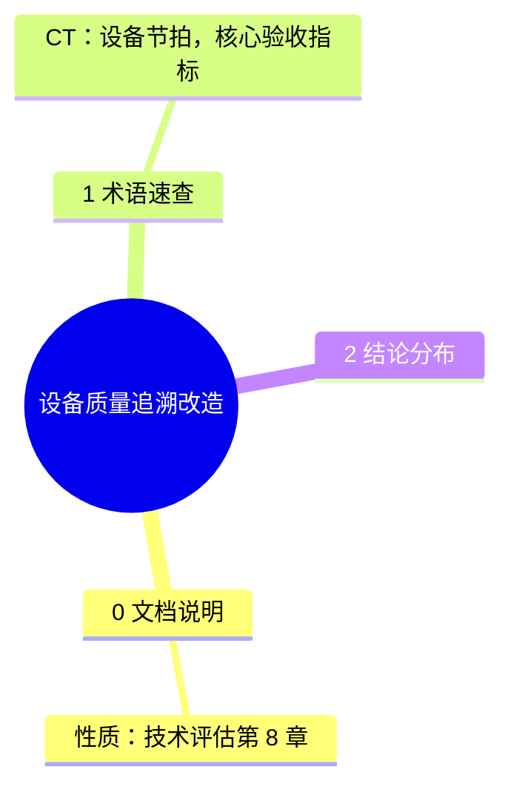

功能说明
====

# 功能说明

本文汇总文档格式与渲染相关的细节：实时模式与离线快照、支持的 Markdown、正文 HTML、跨文档章节引用、
思维导图与 Mermaid 图表。界面操作见 `docs/指南/界面与快捷键.md`，配置项见 `docs/指南/配置说明.md`。

## 实时模式与离线快照

`--serve` 实时模式读文档目录原文（刷新即生效），双击 `md-viewer.html` 读页面内置快照（改完要重跑
`node build-docs.mjs`）。写盘边界很清楚：**只有 `node build-docs.mjs` 这条构建命令会写产物**，
`--serve` 与 `--check` 一个文件都不写（`--serve` 的实时版页面在内存里现生成），
所以 `--serve <别的目录>` 不会顶掉仓库里按默认 `docs/` 生成的 `md-viewer.html` / `docs-index.json`。
两种页面的差别、页面上的「数据来源」提示，以及产物过期检查
（`node build-docs.mjs --check`、`node test/why-stale.mjs`）见
`docs/指南/界面与快捷键.md`。

## 支持的 Markdown

ATX 标题、段落、围栏与缩进代码块、引用（含嵌套）、有序/无序/任务列表（含多层嵌套）、
GFM 表格（含对齐、转义竖线、行内代码）、水平线、行内 `code`/粗体/斜体/删除线/链接/图片/自动链接。
信息串为 `mermaid` 的围栏会画成图（见下面的「嵌入 Mermaid 图表」），其余围栏按代码高亮样式原样输出。

**原始 HTML 默认按纯文本转义输出**（`markdown.html: "escape"`），避免文档里混入脚本；
想让浏览器真正渲染或只留内容，改 `config.json` 即可（见下面的「正文里的 HTML」）。
正文里的脚本结束标签（`script` 的闭合标签）会被转义成 `\u003c`，不会提前闭合页面脚本标签。
样式与应用逻辑都在同目录的 `assets/` 下，页面没有任何外部（跨目录、跨站）请求。

## 正文里的 HTML

Markdown 正文里写的 HTML 标签怎么处理，由 `config.json` 的 `markdown.html` 决定
（**代码围栏与行内代码里的 HTML 永远是源码文本**，三种模式都不动它们）：

| 值 | 效果 |
| --- | --- |
| `"escape"`（默认） | 转义显示：`<div>` 就显示成 `<div>` 这行文字，文档安全，与以前的行为完全一致 |
| `"innerhtml"` | 原样输出：浏览器真去渲染，可写 `<details>` 折叠块、`<span style>` 着色等 |
| `"strip"` | 吃掉标签只留内容：`<div class="note">…</div>` 只剩里面的文字，按普通 Markdown 排版 |

`strip` 模式下：`<br>` 变换行（表格单元格里也生效）、`` 变图片（相对路径照常解析成文档目录下的
文件）、HTML 注释与 `<script>`/`<style>` 连内容一起消失、实体（`&amp;`、`&nbsp;`、`&#65;` 等）
还原成字符；`a < b`、`<user@example.com>` 这类不是标签的写法不会被误吃。想统一套壳、又不想让
标签影响排版时用它。

认不出的值一律按 `escape` 处理。`docs/xxx.md` 引用、`§` 章节引用、左栏摘要、右栏目录在三种模式下都照常可用。

> **安全提示**：`innerhtml` 是把文档当代码信任——`innerHTML` 插入的 `<script>` 不会执行，
> 但属性里的事件（如 ``）会执行。只在完全可信的文档上开这个模式；
> 块级标签与 Markdown 混排时，个别行的行距会不太整齐（属于浏览器解析的固有现象）。

## 跨文档章节引用（「父文档 §4.1」）

裸 `§4.1` 永远只指**本文档**的 4.1。要指别的文档，两种写法：

**一、零声明（推荐）**：目标路径的**行内代码**紧跟 `§` 编号即可，路径的写法与普通跨文档引用一致
（完整虚拟路径，或唯一的文件名）：

```markdown
细节见 `docs/方案/崩溃与掉电场景数据保障方案要点.md` §4.1，以及 `崩溃与掉电场景数据保障方案要点.md` §4.3。
```

**二、文首声明别名**：在正文开始前写声明区（可夹空行、可写在标题前后），
然后正文里就能写「别名 §编号」。别名随便取，可以声明多条：

```markdown
父文档指: `docs/方案/崩溃与掉电场景数据保障方案要点.md`
<!-- 总览: docs/方案/总体设计.md -->

# 文件写入原子化细则（Windows）

写盘顺序以 父文档 §4.1 为准，异常分支见 总览 §2.3。
```

- 声明行**不会**渲染成正文，而是在文章顶部变成一排可点的「引用目标」徽标（父文档 → 崩溃与掉电场景数据保障方案要点），既能核对指向、也能当"回上级"用；
- 注释写法 `<!-- 别名: 路径 -->` 在别的 Markdown 工具里完全不显示，可见行写法 `别名指: \`路径\`` 更好读，两种都能用；
- 声明区只认**正文开始前**的部分（最多扫前 40 行），正文中间的 `XX: docs/xx.md` 不会被误吞；
- 目标文档里找不到该编号时不会静默失效：链接跳到目标文档顶部，并标成**黄色虚线 + 悬停说明**（`missing`）；
- 声明的目标文件找不到时，顶部徽标变黄并标「找不到」；
- 跳转落点会**闪一下**，确认真的跳到了目标章节。

> 声明只影响本文档里带该别名的引用；不写声明时行为与以前完全一致。
> 目前不支持在 Markdown 链接里写纯数字锚点（`[文字](docs/x.md#4.1)`），要指定章节请用上面两种写法。

## 思维导图（Mermaid mindmap）

文档目录里的 `.mermaid` 文件（Mermaid 的 `mindmap` 版式）会被渲染成思维导图，
和 Markdown 文档并列出现在左栏（带一个「导图」小标记），点开即在正文区显示。



对应写法（存成 `.mermaid` 文件，**不要**写 ```mermaid 围栏）：

```
mindmap
  root((设备质量追溯改造))
    0 文档说明
      性质：技术评估第 8 章
    1 术语速查
      CT：设备节拍，核心验收指标
```

画布上的操作（缩放 / 平移、折叠、跳大纲、导出图片、全屏、打印）见
`docs/指南/界面与快捷键.md` 的「思维导图操作」。

语法支持范围（按 Mermaid 的 `mindmap` 版式实现）：

- **缩进即层级**，不要求固定步长；`tab` 按 4 个空格算，与空格混用也没问题。
- **节点形状** 都会识别，只取其中的文字：`id[方形]`、`id(圆角)`、`id((圆形))`、
  `id{{六边形}}`、`id))爆炸((`、`id)云(`；纯文本节点按原样显示。
- **`%%` 注释与 `%%{init: …}%%` 指令**会被跳过；`mindmap` 声明行可有可无。
- **行内格式**：节点文字支持 Markdown 行内语法（粗体、行内代码等），但会被安全转义，
  所以节点里写 `#10`、`a*b*c` 这类内容不会破坏排版。
- `.mermaid` 文件里写的**不是** `mindmap`（比如 `stateDiagram-v2`）时，改由下面的
  嵌入图表引擎按整篇图表渲染，左栏标记也从「导图」变成「图表」。

> 渲染引擎是 [markmap](https://github.com/markmap/markmap)（MIT），已放在 `vendor/markmap/`，
> 由 `node build-docs.mjs` 填进页面：离线版整段内联，实时版走本地外链。升级方式见 `vendor/markmap/README.md`。

## 嵌入 Mermaid 图表（mermaid 围栏）

Markdown 正文里用 ` ```mermaid ` 围栏包住 Mermaid 源码，页面就会把它画成 SVG，
和 `.mermaid` 思维导图一样**离线可用、不装插件、不联网**。


- 支持的版式：`stateDiagram-v2` / `stateDiagram`、`flowchart`、`sequenceDiagram`、
  `classDiagram`、`erDiagram`、`gantt`、`pie`、`journey`、`gitGraph`、`timeline`、
  `quadrantChart`、`requirementDiagram`、`mindmap`、`C4`、`sankey-beta` 等——凡是引擎认的都能画。
- 围栏写法：`` ```mermaid ``、`` ~~~mermaid ``、`` ```{.mermaid} `` 都认，大小写不敏感，附加信息串
  （`` ```mermaid title="x" ``）忽略；`` ```mermaidfoo `` 这类不算。
- 每张图右上角有工具栏：**源码**（就地摊开/收起）、**复制**、**SVG**（导出成文件）、**全屏**
  （铺满窗口，图按比例放大到放得下的最大尺寸——宽图顶满宽度、高图顶满高度，<kbd>Esc</kbd> 退出）。
  语法写错时不会白屏：显示一条含 Mermaid 报错的提示，
  下面自动摊开源码，同一篇文档里其它图表不受影响。
- 主题跟随页面深浅色（切主题会重画；mermaid 的主题是画进 SVG 里的）。
- 引擎是 [mermaid](https://github.com/mermaid-js/mermaid)（MIT），放在 `vendor/mermaid/`。
  **离线版按需内联**：这批文档里没有任何 ` ```mermaid ` 围栏、也没有整篇图表的 `.mermaid`
  文件时，`md-viewer.html` 不会背上这 3 MB（仍是 1 MB 上下），页面里留一个空引擎块兜底；
  实时版始终走本地外链。升级方式见 `vendor/mermaid/README.md`。

相关配置（`config.json` 的 `mermaid` 段，详见 `docs/指南/配置说明.md`）：

```json
"mermaid": {
  "enabled": true,             // false：围栏退回普通代码块，离线版也不再内联引擎
  "theme": "auto",             // auto 跟随页面深浅色，也可写 default/dark/forest/neutral/base
  "style": "doc",              // doc：文档风（圆角浅紫胶囊 + 深灰粗连线 + 灰底标签 + 小三角箭头）；plain：mermaid 原样
  "securityLevel": "strict",   // strict 转义标签里的 HTML；文档可信时才改 loose（可用 <br/>）
  "controls": true,            // 图上的工具栏
  "exportImage": true,         // 工具栏里的「SVG」按钮
  "fullscreen": true           // 工具栏里的「全屏」按钮
}
```

可运行的示例见 `docs/示例/Mermaid 图表.md`（各类版式 + 故意写错的兜底），
整篇图表见 `docs/示例/状态机示例.mermaid`，
样式对照见 `docs/示例/状态图版式对照.md`。