# 嵌入 Mermaid 图表

正文里用信息串为 `mermaid` 的围栏把 Mermaid 源码包起来，页面就会把它画成图 —— **离线单文件也一样，不需要联网**。
引擎（`vendor/mermaid`）已经在页面里，双击 `md-viewer.html` 直接就能看。

围栏写法：`mermaid`（大小写都认）、波浪号的 `~~~mermaid`、Pandoc 风格的 `{.mermaid}` 都行。

## 1. 状态图：stateDiagram-v2

最常用的一类。下面这张是「空闲 → 采集 → 计算 → 输出」的设备状态机：

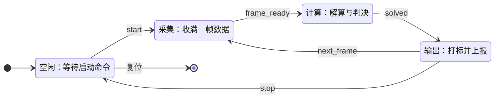

`[*]` 是起点／终点，`A --> B : 文字` 里的文字画在箭头旁边，`direction LR` 控制走向（也可写 `TB`、`RL`、`BT`）。

## 2. 组合状态、分支与注释

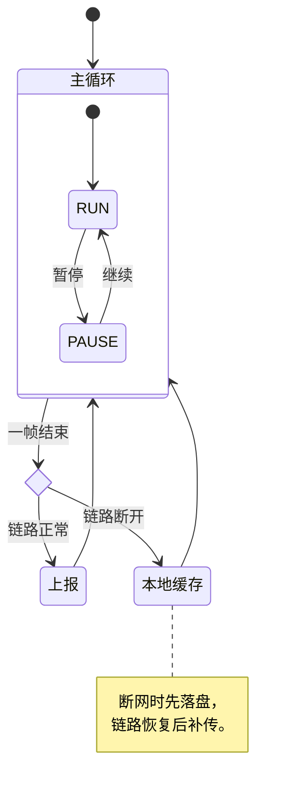

- `state "显示名" as 标识`：给状态起中文名，标识保持 ASCII，可读性最好
- `state 判定 <<choice>>`：选择分支（还有 `<<fork>>`、`<<join>>`）
- `note right of X … end note`：注释块，也可以用单行写法 `note right of X : 文字`

## 3. 状态图 v1：stateDiagram

老写法 `stateDiagram` 一样支持，两种写法按习惯挑一个用：

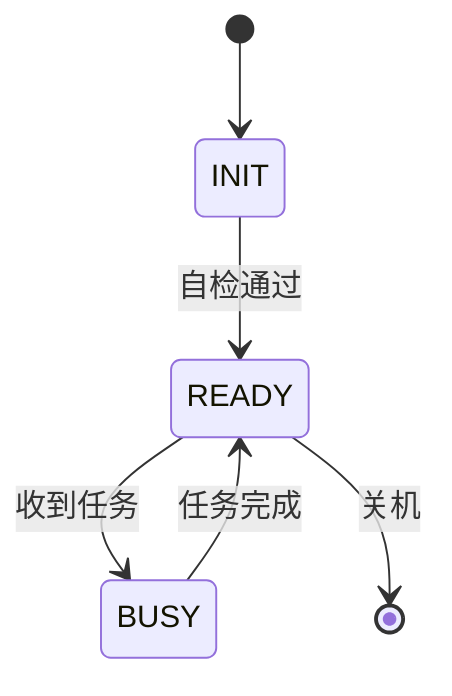

## 4. 其它常用版式

流程图：

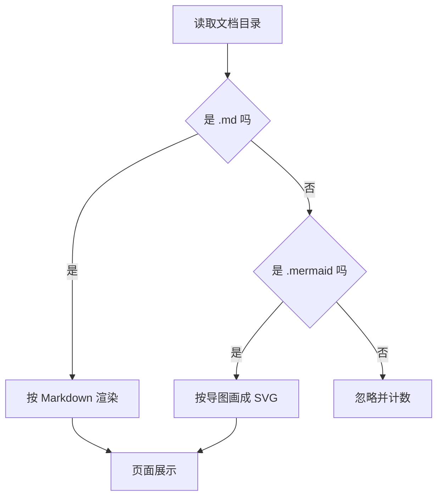

时序图：

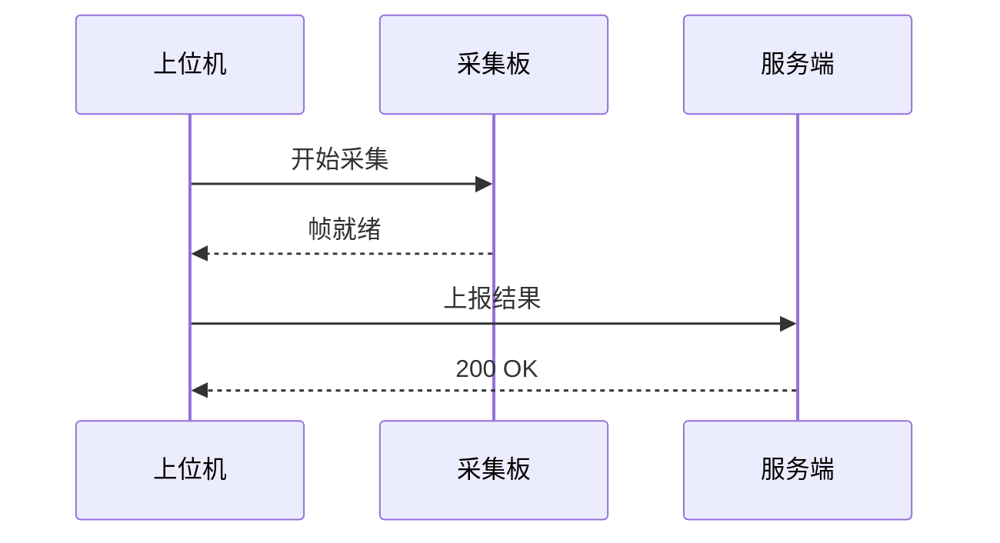

类图（标识用 ASCII，说明写注释）：

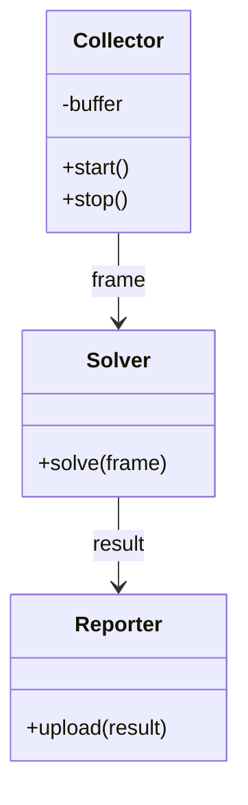

实体关系图：

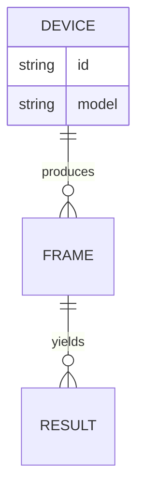

甘特图：

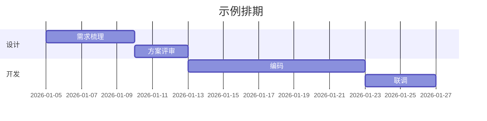

饼图、时间线、思维导图（正文里的思维导图由 Mermaid 画，`.mermaid` 文件走的是另一种可缩放导图）：

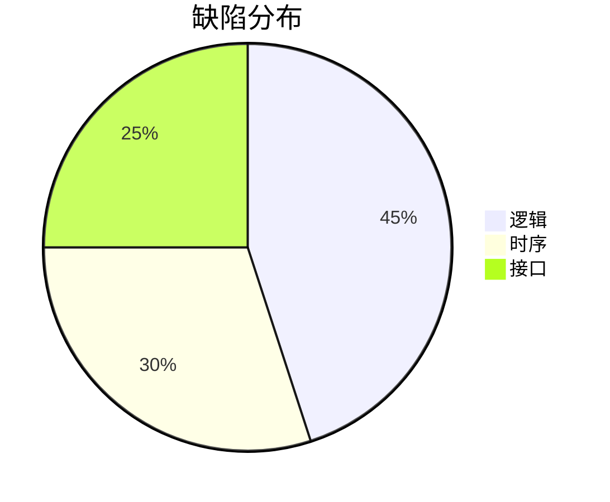

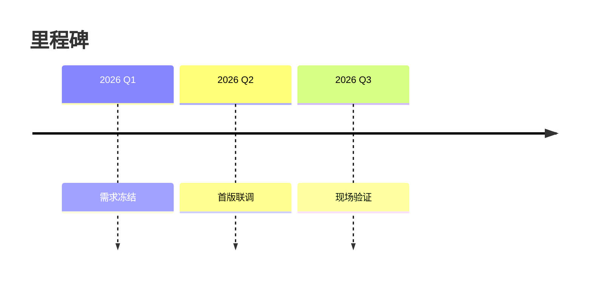

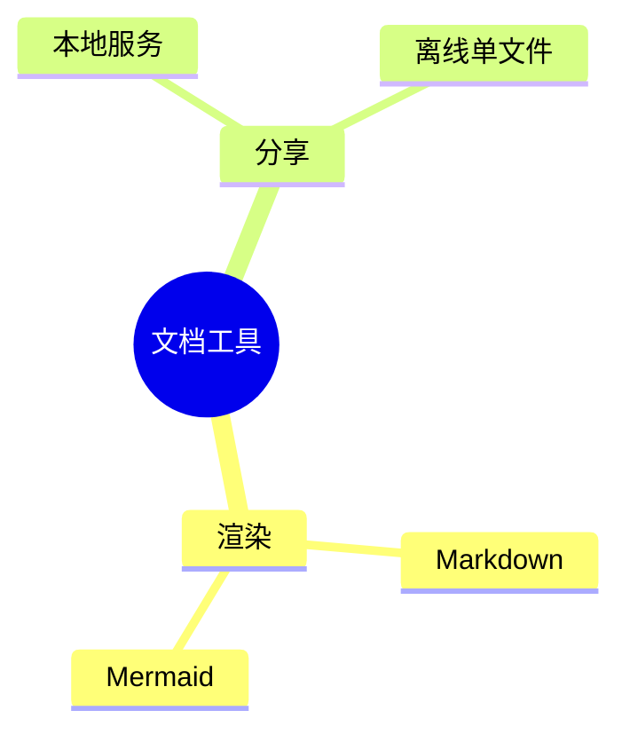

## 5. 每张图右上角的工具栏

| 按钮 | 作用 |
| --- | --- |
| 源码 | 就地摊开／收起这段 Mermaid 源码（语法写错时会自动摊开） |
| 复制 | 把源码复制到剪贴板，方便贴到别处改 |
| SVG | 把当前这张图导出成 SVG 文件（自带配色，单独打开也是对的） |
| 全屏 | 把这张图铺满窗口看细节，按 <kbd>Esc</kbd> 退出 |

嫌工具栏占地方，就把 `config.json` 里 `mermaid.controls` 设成 `false`。

## 6. 语法写错时会怎样

图不会画出来，但**不会白屏、也不会丢内容**：这一块会显示一条提示（含 Mermaid 报的错误），
下面自动摊开源码，改完刷新即可。同一篇文档里其它段落、其它图表不受影响。

下面这块是**故意写错**的（`IDLE --> RUN {` 少了一个配对的大括号），用来演示兜底长什么样：

```mermaid
stateDiagram-v2
    [*] --> IDLE
    IDLE --> RUN {
    RUN --> [*]
```

## 7. 配置（config.json）

```json
"mermaid": {
  "enabled": true,          // 总开关：false 时围栏退回普通代码块，页面里也不再内联引擎
  "theme": "auto",          // auto = 跟随页面深浅色；也可写 default / dark / forest / neutral / base
  "style": "doc",           // doc = 文档风（见第 8 节）；plain = mermaid 原样
  "securityLevel": "strict",// strict 时标签里的 HTML 会被转义；文档可信时才改成 loose（可用 <br/>）
  "controls": true,         // 图上工具栏（源码 / 复制 / SVG / 全屏）
  "exportImage": true,      // 是否给「SVG」导出按钮
  "fullscreen": true        // 是否给「全屏」按钮
}
```

## 8. 观感：`style` 是 `doc` 还是 `plain`

`style` 默认是 `doc`，也就是上面那些图现在的样子。它只调**形状**，不抢配色的活：

| 项目 | 默认（`style: "doc"`） | `style: "plain"`（mermaid 原样） |
| --- | --- | --- |
| 状态节点 | 圆角 10px、浅紫底 + 深紫描边（1.6px） | 圆角 5px、中灰底 + 紫描边（1px） |
| 连线 | 1.6px 深灰 | 1px |
| 转移标签底片 | 不透明浅灰、四周留白 | 半透明（线会穿过文字） |
| 箭头 | 13×11 的小三角 | 20×14 的细长倒钩 |
| 流程图 | 节点描边与连线同样统一到 1.6px | mermaid 原样 |

配色仍然由 `theme` 决定（`auto` 时深浅色各有一套），所以 `style` 和 `theme` 可以随便搭配。
导出的 SVG 里也带着这套样式，单独打开同样好看；不想要就写 `"style": "plain"` 退回原样。
逐项对照与真实渲染见 `docs/示例/状态图版式对照.md`。

## 9. 整篇 `.mermaid` 文件也能画

文档目录里的 `.mermaid` 文件默认按思维导图（mindmap 版式）渲染成可缩放的导图；
如果里面写的是 `stateDiagram-v2` 这类别的版式，页面会直接按图表画出来，
左栏的标记也从「导图」变成「图表」。示例见 `docs/示例/状态机示例.mermaid`。
