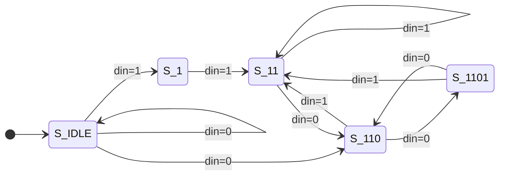
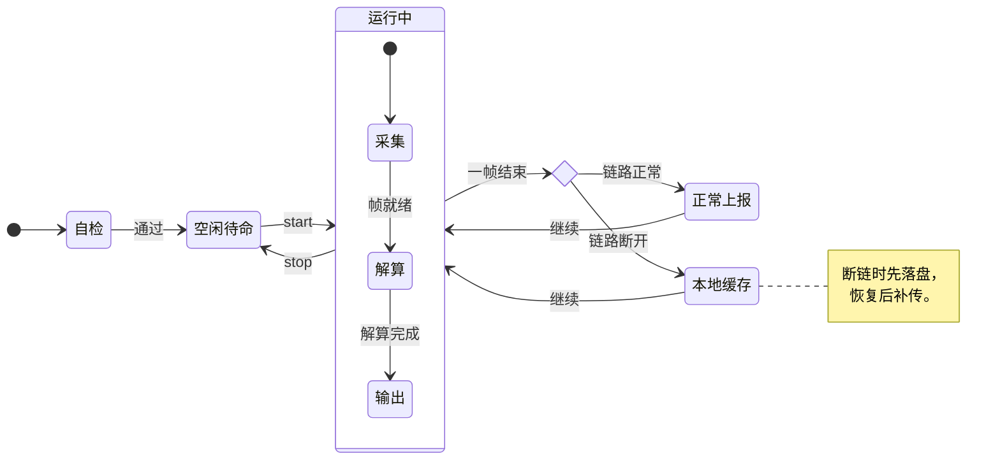
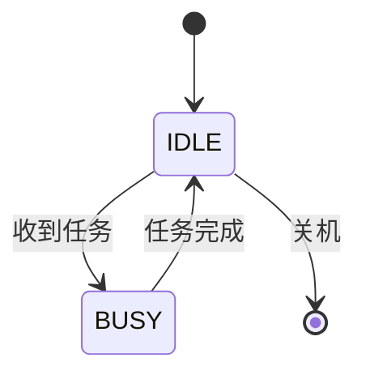
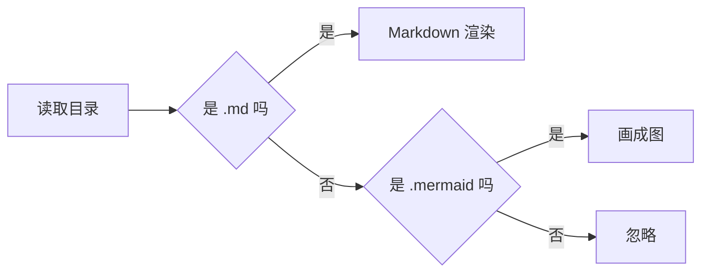
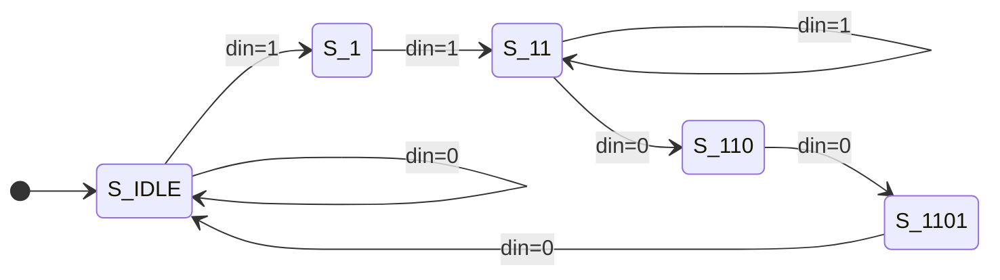

# 状态图版式对照：1101 序列检测器

这篇文档里的状态机与参考图一致（5 个状态 + 起始黑点，`din` 决定转移），
用来逐项核对「状态图长什么样」：节点形状、配色、标签底片、走线、留白。

## 1. 参考样式（目标）

## 2. 中文标签 + 组合状态 + 注释（不能被带坏）

## 3. 默认方向（TB）与流程图

## 4. 布局改不了：层级是 dagre 排的

`style` 只负责**形状**（圆角、线宽、标签底片、箭头），**层级与走线不归它管**。
拿上面那张图试过：把「空闲直接跳到 S_110」那条跨级边去掉，主干不会变平 —— 只要链够长、
又有回边，mermaid 的 dagre 就会排出阶梯状：

上面这张是 698×203（宽高比 3.4），比第 1 节的 698×254 扁一点，但仍是阶梯：S_IDLE、S_1、S_11、
S_110、S_1101 分别落在 5 个不同的 y 上。**参考图那种「主干一条水平线 + 上下对称回边」的平铺，
mermaid 内置的 dagre 排不出来**：状态图的 `rankdir` / `ranker` / 间距都是写死的（`state` 段没有
nodeSpacing / rankSpacing 可配），elk 布局也只对 flowchart 生效。

所以想更接近参考图，只有两条路：**换渲染引擎**（要再塞一个 elk 包，且状态图用不上），
或者**接受阶梯**，把精力放在形状细节上（也就是 `style: "doc"` 做的这些）。
