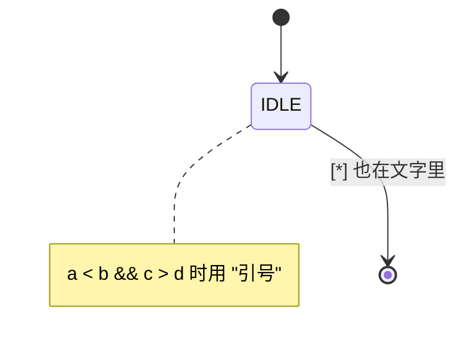

# 位置与转义

列表里的图表（缩进四格以内仍算围栏）：

- 第一种状态机：

  ```mermaid
  stateDiagram-v2
      [*] --> A
      A --> B : 走一步
  ```

- 第二种：

  ```mermaid
  stateDiagram-v2
      [*] --> C
  ```

引用块里的图表：

> 说明一下这张图：
>
> ```mermaid
> flowchart LR
>     X --> Y
> ```

源码里带尖括号、引号、与号、注释、脚本闭合标签，都必须原样保留（页面里不会变成真标签）：


