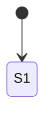

# 围栏变体

大小写照认：

```Mermaid
stateDiagram
    [*] --> A
```

波浪号围栏：

~~~mermaid
flowchart TD
    A[开始] --> B[结束]
~~~

四个反引号的围栏：

````mermaid
sequenceDiagram
    A->>B: 你好
    B-->>A: 你也好
````

Pandoc 风格的信息串：

```{.mermaid}
pie title 占比
    "甲" : 60
    "乙" : 40
```

缩进三个空格的围栏（Markdown 允许）：

 ```mermaid
timeline
    title 里程碑
    2026 Q1 : 立项
 ```

带附加信息的信息串：



不是 Mermaid 的围栏，一律保持普通代码块：

```mindmap
其实这不是围栏式思维导图，只是文字
```

```mmd
flowchart TD
    A --> B
```
